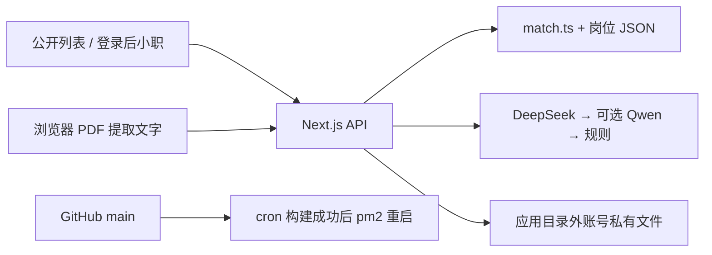

# 职点迷津 · AI 求职助手

## 1. 线上地址与评审入口

**[打开网站：http://118.89.79.239:3000](http://118.89.79.239:3000)**。浏览岗位列表、筛选和搜索免登录；使用 AI 助手“小职”需登录。

**体验账号：`demo / demo2026`**。这是多人共享账号，请勿粘贴或上传真实简历；可自行注册独立测试账号。入口及登录流程见[公开首页](app/app/page.tsx)、[登录页](app/app/login/page.tsx)与[账号接口](app/app/api/auth)。

参赛者承诺自实际提交日起至少 7 天保持实例运行、不释放资源，每日巡检；提交日期顺延则保活截止顺延。具体执行、余额检查与故障处理见 [docs/OPS.md](docs/OPS.md)，这是一项运维安排，不能由一次访问证明未来连续可用。

## 2. 项目定位与核心功能

**帮你排除错误选项的央国企岗位核对工具。** 产品先展示事实，再按个人条件核对，不把聊天回复当作报名资格证明。

**岗位列表与筛选搜索。** 首屏服务端渲染 10 条真实来源样本，支持岗位名、单位、地点搜索及学历、招聘类型、地点筛选，展示条件、截止声明、来源原文与获取时间。范围仅限提交的样本，见[列表界面](app/app/components/JobList.tsx)、[筛选逻辑](app/lib/job-list.ts)及[筛选测试](app/lib/job-list.test.ts)。

**小职助手。** 右下角悬浮面板含自我介绍、快捷问题、账号级气泡偏好、多轮追问和岗位来源引用；服务端按账号保存最近 20 条消息。见[助手界面](app/app/components/JobAssistant.tsx)、[对话接口](app/app/api/chat/route.ts)、[账号偏好](app/app/api/preferences/route.ts)与[账号存储](app/lib/user-store.ts)。

**简历整理。** 支持粘贴文本或在浏览器解析 PDF，再把提取文字交给服务端抽取枚举画像；简历会自动填写条件并提示修改、清空，原文可删除。PDF 文件不上传，文字仍会发送至服务端私有存储；仅前 5 页、5MB、6000 字，不做 OCR。机制见[本机解析](app/lib/pdf-client.ts)、[槽位白名单](app/lib/slots.ts)、[私有画像接口](app/app/api/profile/route.ts)和[实际验收](docs/reports/R7_REPORT.md)。

## 3. 可信性设计

1. **规则与生成分层。** `eligible / ineligible / unknown` 由[match.ts](app/lib/match.ts)计算；画像未确认时为 unknown，明确不符优先，关键未知不放行，见[规则单测](app/lib/match.test.ts)。模型负责解释，[输出校验](app/lib/chat-output.ts)拒绝模型自带 status，[对应测试](app/lib/chat-output.test.ts)验证该闸门；这不保证每句生成文本都正确。
2. **证据锚定。** 每条岗位有 source_url、obtained_at、raw_snapshot、evidence_hash，见[10 条结构化数据](data/processed/jobs.json)与[证据原文目录](data/raw/MANUAL-20261030-220241.pages)。[数据校验器](scripts/validate_data.py)复核原文存在及 SHA256；[数据报告](data/REPORT.md)说明范围与缺口。哈希证明文件一致性，不证明招聘方实时开放。
3. **引用与输出校验。** 非空引用必须属于候选且 ID 与 URL 成对，通用问题可空引用；过长回复、违规承诺或错误引用丢弃并进入下一级，见[校验代码](app/lib/chat-output.ts)、[校验测试](app/lib/chat-output.test.ts)与[调用链](app/app/api/chat/route.ts)。地点、学历、专业与截止直接送入模型证据，见[事实投影](app/lib/model-evidence.ts)及[真实请求验收](docs/reports/MODEL_EVIDENCE_REPORT.md)。
4. **待核验处理。** 来源未写条件保持 unknown，逐条展示“公告未载明项”；已写但用户未提供或规则暂不能解释的条件单列待核对，不把未知写成“不限”或“符合”。依据见[字段契约](data/CONTRACT.md)、[条件摘要与推荐口径](app/lib/recommendation.ts)、[相关测试](app/lib/xiaozhi.test.ts)及[评测结果](eval/RESULT.md)。

**推荐口径 = 只声明已载明条件全部符合，不承诺报名资格。** 当前页面证据缺少部分届别、学位等条款，社保与择业期也没有独立可核验字段，故已载明条件匹配仍须核对原公告；具体数量和范围见第 4 节及[数据报告](data/REPORT.md)。核心三态仍可为 unknown，口径 B 不是把 unknown 改成 eligible，见[口径实现](app/lib/recommendation.ts)。

## 4. 岗位数据说明

- **来源与方式：**职点迷津公开详情页，人工提供 URL 清单后匿名只读串行抓取；采集批次为 **2026-10-30T22:02+08:00**（逐条 22:02:42–22:02:57），请求间隔至少 1.5 秒，未访问 `/api/`。依据为[原运行台账](data/raw/MANUAL-20261030-220241.run.json)、[采集工单](data/COLLECTION_ORDER.md)与[权限边界](docs/DATA_SCOPE.md)。参赛者授权不等同于站点额外许可。
- **覆盖范围：10 条**，来自“央国企 + 校招”筛选的人工样本，**不是全站**。原始证据与范围记录见[数据报告](data/REPORT.md)。
- **核验状态：**10 条由参赛者在 2026-10-31 逐条打开原页核对，数据中 human_verification.state 均为 verified、verified_by 为 contestant；这不是官方认证，也不是个人资格通过。见[核验标记与证据引用](data/processed/jobs.json)。
- **字段缺口：**学历 10/10 有值，专业 1/10、届别 9/10、证书 1/10 有值；学位和毕业时间 0/10 有值。社保、择业期没有独立结构化证据，不据此认定无限制；因此不能给出“确定可报”结论。逐字段情况见[数据报告](data/REPORT.md)与[导入报告](data/IMPORT_REPORT.md)。
- **开放声明：**1 条具体截止 2027-01-25，9 条明确“长期招聘，无固定截止日期”；没有伪造截止日，也不保证招聘方不会提前关闭。见[源数据](data/processed/jobs.json)及[判定代码](app/lib/match.ts)。

## 5. 架构与技术栈

Next.js 15 App Router + TypeScript + Tailwind，腾讯云实例（参赛者提供的 TencentOS 4、2C4G）上以 Node 20、pm2、cron 运行，监听 3000 端口；实际环境与早期冻结选型的差异见[OPS](docs/OPS.md)和[依赖清单](app/package.json)。PDF 依赖要求 Node 20.19+；本机测试使用 Node 24。

模型链为 **DeepSeek（15s）→ Qwen（10s，可选）→ 规则模板**；最终规则兜底使用“小职正在升级中”，每条回复显示来源，Qwen 未配置直接跳过。依据为[调用链](app/lib/model-tiers.ts)、[规则模板](app/lib/recommendation.ts)与[测试](app/lib/xiaozhi.test.ts)。

当前**无数据库**：岗位只读 JSON；用户画像、简历与消息保存在应用目录之外的 `/opt/career-data`，可由 USER_DATA_DIR 指定；不随应用 rsync 覆盖。见[账号文件存储](app/lib/user-store.ts)和[隔离测试](app/lib/user-store.test.ts)。



## 6. 本地运行与部署复现

在应用目录外准备 USER_DATA_DIR；`app/.env.local` 配置 DEEPSEEK_API_KEY、稳定的 PROFILE_COOKIE_SECRET，可选 DASHSCOPE_API_KEY、USER_DATA_DIR。配置不进 Git；缺模型 Key 时走规则核对，缺稳定签名密钥会使重启后的会话失效。字段用途见[应用说明](app/README.md)与[会话实现](app/lib/session.ts)。

```sh
cd app && npm ci && npm run build && npm run start
```

打开 `http://127.0.0.1:3000`。本地 Windows 推荐将 USER_DATA_DIR 设为本项目 `data/private/local-users` 的绝对路径，且必须在 app 目录之外，见[存储约束](app/lib/user-store.ts)。

部署链路为 push → GitHub → 服务器 cron 每分钟 git fetch → 构建成功则重启。参赛者曾实测约 80 秒，通常按 60–90 秒估算；网络或构建异常会更久，不能当作保证。**首次部署与故障排查命令在 [OPS.md](docs/OPS.md)，不在 README 展开。**

## 7. 测试与验证方式

- 在 `app/` 执行 `npm test`：最近一次 **38/38 通过**，覆盖三态、画像确认、引用配对、输出校验、账号隔离、筛选与结构化证据。直接查看[规则测试](app/lib/match.test.ts)、[输出测试](app/lib/chat-output.test.ts)、[槽位测试](app/lib/slots.test.ts)、[账号测试](app/lib/user-store.test.ts)、[列表测试](app/lib/job-list.test.ts)、[小职测试](app/lib/xiaozhi.test.ts)。测试使用 Node 24 的内置 TypeScript 剥离，不代表服务器 Node 20 直接运行 TS。
- 在仓库根目录执行 `python scripts/validate_data.py`：最近结果 **PASS: production records=10**，入口及范围见[校验器](scripts/validate_data.py)。
- 执行 `node --experimental-strip-types eval/run_eval.ts`：[离线评测 RESULT.md](eval/RESULT.md)记录 **一致率 8/8＝100%，已判定项 3/3＝100%，unknown 占比 5/8＝62.5%**。8 例覆盖 4 个真实岗位，没有预期 eligible 正例；**仅覆盖规则层，不含模型生成质量**，不外推为全面准确率。
- 真实模型验收与离线评测分开，历史输出见[校验修复报告](docs/reports/REPLY_GUARD_REPORT.md)及[字段证据报告](docs/reports/MODEL_EVIDENCE_REPORT.md)。本次交付整理不调用模型。

## 8. 已知限制、未完成项与实际投入

1. 入口为 HTTP + IP + 端口，没有 HTTPS，请勿提交真实简历或敏感信息；见[OPS](docs/OPS.md)。
2. 仅 10 条样本，搜索筛选不会覆盖全站，抓取与核验不是持续更新；见[数据报告](data/REPORT.md)。
3. PDF 依赖文本层；扫描件、复杂字体或布局可能失败，只读前 5 页/6000 字，提供粘贴兜底；见[解析器](app/lib/pdf-client.ts)。
4. 部分届别、学位、毕业时间等缺失，社保与择业期没有独立字段证据；没有“确定可报”结论，专业目录也可能需人工解释；见[契约](data/CONTRACT.md)和[规则](app/lib/match.ts)。
5. cron 轮询部署不是标准 CI，不能保证每次 60–90 秒上线；见[OPS](docs/OPS.md)。
6. 模型费用保护仅单进程内存计数，重启重置，没有持久费用监控；见[对话接口](app/app/api/chat/route.ts)。
7. 附件与原始公告正文未系统采集，实时开放状态可能变化；见[数据报告](data/REPORT.md)。
8. 服务端仅保留最近 20 条消息；没有多设备实时同步或冲突合并，不将刷新恢复等同于实时同步；见[存储代码](app/lib/user-store.ts)。
9. 文件存储仅进程内串行锁，缺少多进程数据库锁、密码找回与邮件验证；demo 为共享账号；见[存储代码](app/lib/user-store.ts)和[账号接口](app/app/api/auth)。
10. 引用与提示词不能保证所有生成文本正确；离线评测无 eligible 正例，也不测模型质量；见[评测局限](eval/RESULT.md)。

**实际投入口径：**[TIMELOG.csv](TIMELOG.csv)记录的墙钟区间合并去重后，约 **4.5–4.8 小时**（下界排除 P00 近似段，上界计入该段；整理收尾以最新表为准）。其中包含构建、网络和等待，部分时段未测量；人工耗时与 agent 净工时没有独立可靠计量，不能把这个范围写成精确实际总投入。18:33 前、网页规划和未覆盖的部署/人工操作另计，详见[提交说明](docs/SUBMISSION.md)。

## 9. Git 历史、线上版本与协作记录索引

仓库：[Lucky-Star-Pi/Career-Compass-AI-Job-Assistant](https://github.com/Lucky-Star-Pi/Career-Compass-AI-Job-Assistant)，发布跟随 `main`，保留既有完整 Git 历史，不改写旧提交。

**最后已推送的业务源码基线为 [e122c2c](https://github.com/Lucky-Star-Pi/Career-Compass-AI-Job-Assistant/commit/e122c2c)**（打开画像编辑区时滚动与聚焦）。后续评测/文档提交不改业务；服务器构建的精确 HEAD 未由本次读取，当前状态与证明范围见[交付核验报告](docs/reports/DELIVERY_REPORT.md)。**正式线上提交版本以参赛者最终确认后创建的 `tag v1.0-submit` 为准，该 tag 尚未创建。**参赛者打 tag 后应在提交说明登记其 commit；本轮不会创建 tag。

push 后服务器约每分钟检查并构建，通常 60–90 秒，成功与否需按[OPS](docs/OPS.md)核验，不能仅凭 push 宣称上线。

**原始记录未随公开仓库交付。** [native-manifest.jsonl](agent-records/native-manifest.jsonl)仅含 4 份原生快照的哈希、字节数与行数，不是原件内容。原件可能含本机路径、内部上下文和敏感信息，未经参赛者审查不能公开；另行加密交付原件及脱敏副本的规则见[DELIVERY_PLAN.md](agent-records/DELIVERY_PLAN.md)。协作索引见[INDEX.md](agent-records/INDEX.md)，缺失范围见[MISSING.md](agent-records/MISSING.md)；后写验收总结不替代原始协作记录。

## 10. 目录结构

```text
app/                   Next.js 应用、规则、API 与单测
scripts/               采集/导入/数据校验的正式 Python 脚本
eval/                  固定 8 例画像、离线 runner 与数字结果
data/processed/        当前 10 条结构化岗位
data/raw/              原文证据、人工录入表和采集台账
data/raw/archive/      历史批次表/台账，保留归档映射
data/fixtures/         明确标记的虚构管线样例，非真实岗位
docs/                  提交说明、选型、边界、计划与运维
docs/reports/          实测报告与归档清单
agent-records/         协作索引、原件哈希、缺失与交付规则
agent-records/notes/   后写验收说明，不是原始会话
```
